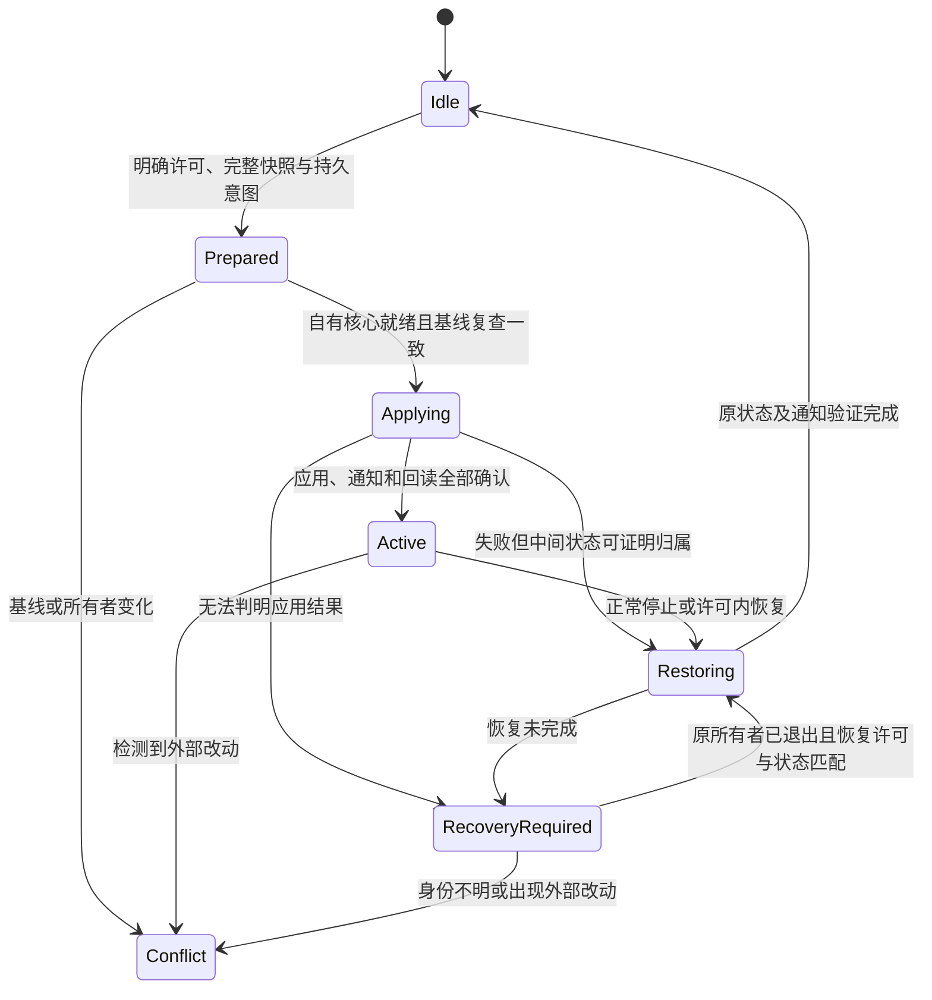

# ADR-0013：Windows GPUI 实验性并行迁移

- 状态：Accepted（仅实验性并行开发范围）
- 日期：2026-10-19
- 决策来源：用户明确选择“进入实验性并行迁移”，授权开始完整业务接入；保留 Tauri 稳定实现和 Android，隔离身份与数据，不包含生产切换、系统代理/TUN 接管或发布授权。

## 背景

[ADR-0012](0012-gpui-desktop-local-validation.md) 已验证原生 Windows 窗口、编辑器、共享 Rust 服务复用、真实核心生命周期、代理与连接、持久统计和运行日志。证据足以开始完整业务迁移开发，不足以宣布现行桌面替换、性能收益或发布就绪。
验证程序的固定核心配置和样例编辑器不是订阅、覆写和设置业务的替代实现。下一阶段按完整用户任务接入真实数据与共享服务，不以增加演示页面作为迁移进度。

## 决定

### 两个应用，一个业务实现

- `apps/client` 继续承载现行 Tauri 桌面及 Android；现有安装、更新、签名和便携身份不变。
- GPUI 实验应用入口为 `apps/desktop`，使用独立 Cargo 项目和带实验标识的可执行程序/窗口。它不嵌入 WebView，不加入 Android 目标，不自动替换现行桌面入口。
- 复用 `lanpath-client`、`lanpath-engine`、`lanpath-common`、`lanpath-script` 和 `lanpath-mitm` 中适用的业务能力；Tauri 与 GPUI 分别适配窗口和平台事件。共享语义不在两个壳内各自实现。
- GPUI 的草稿、选择和任务状态由对应 Rust feature/entity 拥有，不把 React 的 Query/Jotai/Zustand 机制移植成第二个权威状态源；Tauri/Android 的现有状态规范保持不变。
- 保持 sing-box 单核心技术路线；实验实例和现行实例的进程、控制端口及数据根必须隔离。并行开发不等于允许共享写入或共同控制全局网络状态。

### 数据和系统权限

- 实验应用不自动读取、迁移或删除 `~/.lanpath`、现行 Portable 数据、WebView 数据或生产数据库。只使用自身数据或用户明确提供的测试输入。
- 实验数据根必须能在重开应用后恢复其自身已保存内容；“临时目录可被系统清理”不能充当常规持久化契约。
- 核心监听与 Clash API 限于实验实例的 loopback 端口；本阶段不启用 TUN、不调用系统代理设置，不允许配置编辑绕过该边界。
- 后续系统代理/TUN 验证必须单独确定控制权与恢复方案并取得授权，不能因本 ADR 已接受而默认放行。
- 不新增发布密钥、安装器/updater 身份、自动迁移、强制 CI 门禁或 Android 发布步骤。ADR-0012 的本机原生 Windows Rust/MSVC 验证例外继续适用于本实验目标；其他环境仍按仓库 Nix 规范。

### 迁移单位和切换条件

每个迁移单位完成真实输入、持久化、业务操作、错误恢复和原生行为验证；已经暴露的操作不得是占位、假成功或样例数据回显。未迁移能力在覆盖记录中明确，不以同名页面宣称对等。

正式替换仍需独立决策，至少应有完整任务覆盖、数据兼容和回退、系统集成、所需目标架构、安装更新路径、复杂输入/无障碍与同负载资源对照的实际证据。Tauri 在该决策前保留可用，不以本 ADR 接受状态推定已经取代 [ADR-0001](0001-independent-client.md)。

## 后果

当前批准的是可撤回的实验性完整业务迁移开发，不是两个正式发行版，也不是生产数据双写。验证成果保留在 ADR-0012；本 ADR 仅扩大开发阶段，不抹去已有的验证限制或把缺失能力改写为已完成。

## 迁移覆盖基线

基线为批准本阶段时的 `0e87b89`，按完整用户任务统计，而不是按能打开的页面统计。以下缺口不因应用改名而视为完成。

| 用户任务                                                         | 既有复用边界                                                                              | 阶段开始时 GPUI 覆盖                        | 当前 GPUI 覆盖（2026-10-23）                                                                                                     |
| ---------------------------------------------------------------- | ----------------------------------------------------------------------------------------- | ------------------------------------------- | -------------------------------------------------------------------------------------------------------------------------------- |
| 添加/编辑订阅、刷新节点与用量、选用、查看/导出原文               | `lanpath-client::subscription`、`SubscriptionStore`                                       | 未接入                                      | 已接入；刷新失败保留上次成功缓存                                                                                                 |
| 创建覆写、校验 YAML/JS/远程 URL、保存、绑定订阅并重启生效        | `ProfileStoreV2`、`validation`、`profile::overrides`                                      | 仅编辑器技术验证，无业务闭环                | 已接入保存、绑定、关联删除保护与重开恢复                                                                                         |
| 预览最终配置、启动所选订阅、启动阶段与失败反馈、重开使用已保存值 | `profile::build_core_config_v2`、`core_config`、`state/start`、engine                     | 仅固定配置的隔离启停和正常退出              | 已接入 v2 生成、真实预检与启动重新生成、每次读取持久核心选择、真实阶段/耗时/失败记录及重试                                       |
| 全部策略组、节点选择持久化、测速、规则/全局/直连模式             | `proxies`、`persist_group_selection`、`set_rule_mode_persist`                             | 仅固定 `proxy` 组的即时选择                 | 已接入全部组、持久选择/启动恢复、节点/整组测速和模式持久化/热同步                                                                |
| 活动连接、会话关闭记录、流量与路由、关闭连接                     | `connections`、`ConnectionTrackerHandle`                                                  | 已接真实服务，尚非完整业务会话集成          | 已接入同一 tracker 活动/关闭快照、累计字节、稳定 ID 选择、完整连接详情和关闭操作                                                 |
| 今日/历史统计、日期/关键字/排序、清空、离线重开                  | `StatsStore`                                                                              | 已有真实汇总/默认查询，缺完整查询及清空交互 | 已接入共享完整查询条件、全部排序/方向/条数上限、清空确认与过期结果隔离；停核及重开可读历史                                       |
| 运行日志、暂停/过滤/全文、磁盘日志尾读及导出                     | 应用 tracing、核心日志 API、共享 `DiskLogService`                                         | 已有真实内存流，磁盘/导出未接入             | 已接入隔离应用/核心日志持久化、有界磁盘尾读和真实明文导出；内存清空不删除磁盘文件                                                |
| DNS/出站/策略/默认路由/缓存的结构化编辑、验证和持久化            | `ConfigSlicesStore`、`ConfigSlices::validate`、`dns_probe`                                | 未接入，固定 JSON 字段不算编辑能力          | 已接入共享完整 slices 草稿、跨切片校验/原子保存、DNS 探测、重开恢复与配置重新生成；路由规则/规则集 CRUD 仍属下一行               |
| 规则/规则集 CRUD、市场、分类、更新、引用、缺失资源降级与补齐     | `LocalOverrideStore`、`LocalOverrideService`、`RuleSetManager`、`ruleset_update`          | 未接入                                      | 已接入共享完整草稿、规则 CRUD/排序/引用/最终路由、规则集 CRUD/分类/市场/单项与批量更新、缺失资源补齐、重开恢复和配置重新生成     |
| 远程脚本/片段、导入、参数、刷新、调度与任务结果                  | `RemoteResourceService`、`RemoteManager`、`import`、`ScriptTaskSession`、`lanpath-script` | 未接入，样例 JS 不等于执行/管理             | 已接入清单 CRUD/启停、元数据嗅探、模块参数、手动批量更新、Surge/Loon 导入、核心生命周期调度、手动运行与结果；MITM 效果仍属下一行 |
| MITM 白名单、CA、信任和抓包记录                                  | `state/mitm`、`lanpath-mitm`、平台证书适配                                                | 未接入；CA 系统变更另行授权                 | 已接入手动/派生白名单、运行时 rewrite/hook 链、隔离 CA、信任查询、显式确认安装和内存抓包；本轮未实际安装系统 CA                  |
| 请求代理、GitHub 镜像、外观及重开恢复                            | `ClientConfig`、`request_network`、共享 GitHub 探测、GPUI theme token                     | 未接入，不以 GPUI 默认主题冒充迁移          | 已接入四种请求策略、显式保存/重载、已保存快照探测与独立外观持久化；键盘和原生设置闭环见本轮验收                                  |
| age 备份、解密预览、确认恢复、停止、重启事务与外观恢复           | 共享 `backup::BackupService`、既有 age/预览/事务和平台文件适配                            | 未接入，不能以普通 JSON 保存代替            | 已接入密文导出、v1/v2 摘要、一次性确认、停核与加密回滚、租约安全重启、启动事务及兼容外观恢复                                     |
| 核心版本管理、端口/IPv6/面板、系统代理/TUN 授权与回滚            | 共享 `CoreManagementService`、`cores`、`privilege`、`sysproxy`、engine                    | 仅显式指定独立核心；全局系统控制未授权      | 已接入通道检查、隔离下载/校验/选中/删除、诊断与关于；端口仍固定，其他系统设置及全局控制未授权                                    |
| 安装/Portable、种子/许可资产、通知/opener、单实例、更新和回退    | 现行桌面 storage、平台适配、updater、发布工作流                                           | 未接入，现行身份与发布契约不变              | 未变                                                                                                                             |

此表保留 2026-10-23 的阶段快照，不代表后续功能仍未实施。条件式系统控制、可配置端口、
独立安装/Portable、签名更新和事务导入的后继决策见 [ADR-0014](0014-gpui-native-integration-and-distribution.md)，
当前行为与目标平台验收边界见[开发文档](../development.md#windows-gpui-实验性并行)；实现存在不等于验收完成。

接入时保留这些业务约束：

- 唯一生效订阅为 `active_subscription_id`，模板通过订阅的 `profile_id` 关联；订阅贡献节点，不直接接管本地策略和规则。
- v2 合成顺序保留节点、本地模板、slices、远程 YAML、本地 YAML、远程 JS、本地 JS，随后再 compose、local override、面板特性及规则集物化。JS 的 `main` 文本检查不是语法/执行或核心配置校验。
- 预览可能拉取/缓存资源，不作为严格只读且必然等同运行配置的 API；保存成功不等于已热生效。
- 请求策略保留 none/system/core/custom，镜像只改 URL；原文查看/导出读取成功缓存，不重新请求或冒充合成配置。
- 备份保留白名单、age、一次性预览和启动事务及 v1/v2 兼容；规则集保存保留 backing files 和后端更新元数据。
- 不以初始化 `ClientState` 绕过实验边界：当前 `ClientState::stop()` 会调用系统代理关闭，即使启动开关为 false。实验壳按能力接入或提取框架中立编排，不能用无操作平台适配假装已支持。

## 首个业务迁移单位：实验配置文档

该阶段将验证程序迁至 `apps/desktop`，并以可编辑完整 JSON 验证真实 checker、持久源和生命周期。
这是进入业务迁移前的临时切片；下面的“订阅、覆写与配置合成”单位已删除该运行源和编辑入口，
改由真实业务数据生成配置。以下条目保留为当时的安全与交互验证记录，不描述当前配置来源。

- 默认持久根与两个新环境变量、启动/检查命令见[开发指南](../development.md#windows-gpui-实验性并行)。
- `DataRoot` 在服务创建前验证祖先、所有权与文件树，持有真实 OS 独占锁至服务和 executor 释放；
  拒绝目录不会进入配置或离线统计服务，不以伪平台适配绕过权限。
- 该阶段以 `configuration.json` 为唯一保存源；首次新建文档未保存不可启动。校验不保存，保存不热应用，
  启动只消费重新加载且通过同一 checker 的已保存值。失败保留原文件和当前草稿。
- 运行/切换/配置操作期间只读；重新载入与正常关闭处理未保存确认，关闭等待已接受任务再停日志、
  tracker 和核心。已有实时代理、连接、统计、日志继续使用同一隔离实例。
- checker 是选定核心的 `check -c … -D …` 子进程，不是文本模拟；20 秒超时并回收，持续排空输出，
  有界保留诊断。能力策略不取代核心 schema，也不会静默改写不被允许的字段。
- 本阶段固定 loopback mixed/API；拒绝重复 JSON 键、Go 大小写字段别名、额外监听、TUN/系统副作用、
  隐式外部文件与未审定能力；资源仅允许根内相对路径或规范化后仍在根内的生成绝对路径，日志/缓存输出限各自目录。
- 路径边界同时拒绝核心的 `$` 环境变量展开和 Windows 硬链接；`..` 在 Windows 绝对化可能消去之前检查。
  这是受控实验目录的准入和配置约束，不是对同用户恶意运行期篡改的 OS 沙箱。

## 第二个业务迁移单位：订阅、覆写与配置合成

完整 JSON 编辑器不再是运行配置源。`BusinessService` 复用 `SubscriptionStore`、
`ProfileStoreV2`、订阅拉取/解析、覆写解析和 `build_core_config_v2`，并将实验网络边界规范化到
独立 `client.json`。订阅、成功原文/节点缓存、活动选择与模板均位于实验根；不读取或迁移生产数据。

- 订阅支持添加/编辑、刷新、启停、设为当前、模板绑定、成功原文查看和根内导出。相同 URL/UA
  刷新失败只写错误，不删除上次成功缓存；URL/UA 变化会清除旧缓存，迟到响应不能恢复旧地址或元数据。
- 覆写模板在一次持久化前校验名称、本地 YAML/JS 和远程 URL；无效新增不会留下半成品，
  有关联订阅时拒绝删除。订阅和模板的脏表单切换、删除及关窗都有确认。
- 生成顺序保持节点、本地模板、slices、远程 YAML、本地 YAML、远程 JS、本地 JS，再执行 compose、
  local override、实验面板特性和规则集物化。远程降级警告与规则集缺失按共享策略记录。
- `ConfigView` 只展示生成结果；每次预览经过实验能力边界和真实核心 `check`。订阅/模板并发变更
  会排队重新生成，旧预览不能重新开放启动。`DesktopRuntime::start` 不信任预览文本，会重新生成、
  补齐内置规则集并再次校验后启动。
- mixed/API 固定为 `127.0.0.1:17899` 和 `127.0.0.1:19090`，请求代理强制 `none`，
  系统代理、TUN、MITM 和外部面板下载保持关闭。此切片不扩大 ADR 对全局网络控制的授权。
- 普通回归覆盖活动选择/模板/订阅重开、无效模板与引用的原子失败、刷新失败保留成功缓存以及
  生成配置边界；显式真实核心用例另外覆盖生成配置的 checker、启动、运行状态和停止。

该阶段当时完成覆盖矩阵前三项的实验主闭环；策略组完整交互随后由下面的第三个迁移单位完成。
结构化设置、规则管理、远程任务、MITM、备份、核心管理、安装更新和系统集成仍按矩阵保留，
现行 Tauri/Android 仍是生产实现。

## 第三个业务迁移单位：代理策略与路由模式

`ProxyView` 取代壳层固定 `proxy` 组状态，直接消费共享 `ProxyList`，枚举核心返回的全部策略组，
并在成员列表展示节点类型、UDP 能力和最近测速结果。组切换是视图状态；只有 Selector 成员确认
才调用核心选择接口，成功后写入实验根 `client.json`。

- 所选节点与当前组测速分别调用共享 `clash_test_delay` 和 `clash_test_group`；整组并发上限保持 8，
  Tauri 命令删除重复编排并复用同一实现。超时保留为 `None`，不伪造延迟。
- 规则/全局/直连模式先持久化；运行时再热推送 Clash API。热推送失败不回滚已经成功的持久化，
  UI 明确报告同步警告；生成配置的 `default_mode` 和下一次启动仍使用保存值。
- 核心启动等待实验 Clash API 就绪，严格推送保存模式，再尽力恢复各组有效选择；陈旧组或成员
  不能阻断启动。停止清除实时组快照但不删除模式或选择，重开后从独立实验根恢复。
- 读取失败保留最后成功快照，选择失败恢复列表选中状态；停核、关闭和新会话使用 generation/
  busy 边界拒绝迟到结果，不允许与核心生命周期并发改写。
- 端口和能力边界未扩大：仍只控制 `127.0.0.1:19090` 的实验核心，不调用系统代理或 TUN。

这完成覆盖矩阵中的代理策略用户任务，但不改变其他未迁移项，也不构成正式桌面替换授权。

## 第四个业务迁移单位：结构化配置

`ConfigSlicesView` 直接持有共享 `ConfigSlices` 草稿，不在 GPUI 壳复制 schema 或持久化协议；
`BusinessService` 只适配 `ConfigSlicesStore`、内置 DNS 显示语义和共享 `dns_probe`。保存后重新读取
store 归一化结果，并通知只读预览重新生成。

- DNS 覆盖跟随系统/接管、全局与服务器策略、服务器类型和拨号字段、规则匹配/动作及当前服务器
  探测。显示内容与内置 DNS 完全相同时持久化为 `FollowSystem`，否则持久化为 `Takeover`。
- 出站覆盖 VLESS、VMess、Shadowsocks、Trojan、Hysteria2、Selector 和 URLTest 的共享字段；
  内置组可以调整启用、默认成员、测速与中断参数，但名称、协议和动态成员仍由共享规格归一化。
- 默认路由、默认域名解析器和缓存文件进入同一草稿与一次原子保存。数值解析失败保留输入原文；
  共享 `ConfigSlices::validate` 统一检查 tag、引用、协议、端口、规则动作和跨切片约束。
- 删除服务器、规则或自定义出站先确认；重新载入脏草稿和关闭窗口均确认放弃。校验/保存失败保留
  草稿与上一份文件，读取/探测错误可在同页重试。
- 运行中及核心生命周期切换期间全部结构化输入锁定，不热应用；未保存结构化草稿会阻止启动，
  避免实际启动旧持久值。停止后恢复编辑，保存成功才使预览失效并重新生成。

该单位完成覆盖矩阵中的结构化配置任务，不扩大实验端口、系统代理、TUN、生产数据或发布授权。

## 第五个业务迁移单位：规则与规则集

`RulesView` 直接持有共享 `LocalOverride` 草稿；保存、分类和规则集更新由
`lanpath-client::local_override::LocalOverrideService` 统一编排，GPUI 与 Tauri 不再各自维护写锁、
校验、后端更新时间合并或 backing file 语义。

- 路由规则覆盖共享 match/action/advanced 字段、启停、添加、编辑、删除和顺序调整。规则集目标保留
  多 tag 引用；第一个启用的 Final 规则覆盖结构化默认路由，页面同时解释该优先级。
- 规则集支持远程 source/binary 和手写 source，分类可多选后批量应用；内置项仍是可编辑、可删除的
  普通项，并提供显式恢复，不在保存或重开时偷偷复活。
- 市场直接读取现行 MetaCubeX 目录源，支持 geoip/geosite、GitHub Raw/jsDelivr、搜索和分类后添加，
  不另建第二份条目清单。远程规则集支持单项智能更新和全部更新，后端条件请求、指纹、检查时间与
  上游更新时间由共享服务维护。
- 预览和启动都会按实际引用补齐缺失 backing files；下载失败不伪装成功，最终配置预检显示错误。
  删除规则集允许保留失效引用，页面明确标记，用户可恢复同 tag 资源或修改引用。
- 未保存规则草稿阻止启动；运行、启动、停止、保存和更新期间编辑锁定。重新载入、切页和关闭窗口
  均保留既有脏状态确认，保存成功才使最终配置预览失效并重新生成。

该单位完成覆盖矩阵中的规则与规则集任务；不改变实验端口、系统代理、TUN、生产数据或发布授权。

## 第六个业务迁移单位：远程脚本与任务调度

`ScriptsView` 通过共享 `RemoteResourceService` 管理实验根中的远程资源清单，不在 GPUI 和 Tauri
各自复制清单归一化、并发写入或缓存语义。`ScriptTaskSession` 统一从缓存创建调度器、列举状态、
手动执行和停止；现行 Tauri 的批量更新/导入在核心运行时也通过同一客户端会话重建调度器。

- 远程资源支持添加、编辑、启停和删除；名称、HTTP(S) URL、GitHub Raw 归一化、描述、图标、
  更新间隔、方言和参数值由共享服务校验并原子写回。既有名称作为持久身份不可改名，删除清单
  保留缓存，避免意外破坏运行中的任务。
- URL 嗅探识别纯 JS/配置片段与 Surge/Loon 方言；可访问片段读取头部名称、描述、图标及参数声明。
  参数以 `key=value` 保存，未显式填写时沿用声明默认值。
- “立即更新全部”只处理已启用资源，下载片段及其脚本/任务源并重建缓存，逐项失败进入警告而不
  伪造成功。`update_interval_secs` 目前只随清单持久化；仓库没有自动刷新编排，界面不再宣称按
  间隔自动拉取。
- 配置导入支持 Surge/Loon 的 rewrite、hook、cron 和 hostname 语义，采用既有追加缓存契约。
  本单位编译 `lanpath-mitm` 仅为复用片段解析/缓存类型；GPUI 运行时没有启动 MITM 代理、安装 CA
  或修改系统信任，rewrite/hook/hostname 的运行效果仍留在下一迁移单位。
- 实验核心启动前从缓存建立调度会话，启动失败、停止和关窗都会显式停止并等待调度任务；无有效
  cron 时不创建空会话。任务页展示 cron、下次/上次运行与错误，可手动执行并显示真实脚本输出。
- 远程资源和导入的未保存正文阻止启动；核心运行和生命周期切换期间锁定这些写操作，任务手动
  运行保持可用。停核后重新载入任务缓存；关闭前等待已接受操作并纳入放弃修改确认。

该单位完成覆盖矩阵中的远程脚本和调度任务；不扩大实验端口、请求代理、系统代理、TUN、MITM、
生产数据或发布授权。

## 第七个业务迁移单位：MITM、CA 与抓包记录

`MitmService` 从现行 `ClientState` 提取框架无关的白名单合并、远程 rewrite/hook 装载、CA、信任状态、
代理生命周期和内存记录语义；Tauri 命令与 GPUI 运行时都复用该服务，不再各自维护证书路径和信任适配。

- `MitmView` 保存开关和手动 Hostname，展示远程片段/本地导入派生来源；空白名单不启动代理，
  `-`/`!` 排除项不生成核心劫持规则。草稿会阻止核心启动，重载和关窗丢弃均需确认。
- 核心启动时先启动 MITM，再以实际随机 loopback 代理地址合成 `main-in`、固定 `17900`
  `mitm-return`、`lanpath-mitm` outbound 和白名单路由；实验能力策略只新增这一严格形态，
  继续拒绝额外监听、非 loopback、TUN 和系统代理。
- 缓存中的 rewrite 与脚本 hook 使用远程资源参数和实验根脚本存储实际执行；启动、失败回滚、
  停止及关窗均持有并释放同一 `MitmSession`。流量记录保持进程内有界内存，页面两秒轮询，
  不写生产日志或历史数据库。
- CA 证书和私钥只生成在实验根 `certs/`；页面可查询系统信任、复制 PEM。安装信任库必须经过
  独立确认对话框，且不会启用系统代理。本轮验证不触发安装操作，因此不把“按钮可用”记为已验证
  的系统证书变更。
- 预览仍验证不含临时代理地址的基础配置；启动会重新生成并对带实际 MITM 动态链的最终配置执行
  同一能力边界和真实核心检查。保存不热应用，运行中设置锁定。

该单位完成覆盖矩阵中的 MITM 用户任务，但不授权生产数据、系统代理、TUN、安装器或发布切换。

## 第八个业务迁移单位：运行观测闭环

导航改为“配置 / 运行 / 扩展”分组侧栏，核心启停和状态在内容区保持可见；不把导航重排单独
计算为完成的用户任务。连接、统计和日志的状态仍由各自 entity/service 拥有。

- 连接显示同一 `ConnectionTrackerHandle` 的活动快照、关闭缓冲及对应字节总量；保留 HTTP
  健康检查，读取失败不覆盖最后成功结果。选择按连接 ID 保留，详情显示目标/IP、协议、出站链、
  命中规则、字节和开始时间；仅活动连接可执行关闭，旧会话请求不能污染新会话。
- 统计直接消费 `DailyQuery`/`RecordsQuery`：日聚合支持本地单日、搜索和精确出站，明细支持搜索；
  全部排序字段、方向和 1–1000 条上限均传入 store。界面明确明细 API 不支持日期边界及精确出站，
  达到返回上限时提示可能仍有匹配结果，不伪装为分页或完整结果。单行预览配只读带标签详情，
  聚合选择按复合键、明细按主键保留，不因排序或计数更新切到另一条记录。
- 清空需确认并作用于全部实验聚合/明细，不限当前筛选。已接受查询先完成，清空优先于下一次
  查询，旧结果不得恢复已清空快照；当前 tracker 保留基线并继续采集新增量。停核和重开仍可查询。
- `lanpath-client::logs::DiskLogService` 提取原 Tauri 文件枚举、有界尾读和导出，两个壳共用同一
  实现。GPUI 显式增加自身 `core.log`，Tauri 默认可查看文件集不变。拒绝路径穿越、链接和非普通
  文件；尾读最多 2 MiB/1000 行，正确处理 UTF-8 中途截断和完整行边界。
- GPUI 应用日志每日写入 `logs/app.log.YYYY-MM-DD`，核心日志实时订阅写入 `logs/core.log`；
  有界后台文件队列不阻塞 UI，丢弃或写入错误显式展示。磁盘页支持类型/文件切换、刷新、只读尾部、
  导出和复制路径。导出在实验根 `exports/` 拼接真实原文，不包含旧导出或配置快照；文件未加密，
  分享前需检查访问目标。内存清空确认不会删除任何磁盘日志。
- 正常关窗禁止新观测写操作，并等待已接受的连接操作、统计查询/清空、日志读取/导出，再停止
  tracker/日志订阅/核心并释放数据目录锁；后台日志 worker guards 由 runtime 持有而非全局订阅器。

该单位不触碰系统代理、TUN、生产数据或发行身份；系统集成仍按第 12 单位单独授权。

## 第九个业务迁移单位：请求与外观设置

网络请求继续使用共享 `ClientConfig`/`request_network`，不引入 GPUI 专用 HTTP 客户端或另一套代理语义。
实验首装仍设为 `none`，后续读取不再清空已保存策略、URL 或 GitHub 前缀；已规范的配置读取不重复
写盘，确需修复的实验根、端口、核心和系统副作用字段继续归一化并持久化。请求页保存时重读当前
配置，只合并请求字段，原子替换后才更新保存快照，不覆盖其他页面此前保存的选择、模式或 MITM。
请求编辑在核心运行/启停或其他配置操作时锁定；停核后可修改，核心代理不可用时失败而非回退。
自定义 URL 整体遮蔽；凭据仍以明文保存在实验 `client.json`，不得把遮蔽显示解释为磁盘加密。

GitHub 前缀沿用共享域名判断、空值和斜杠语义，内置规则集镜像回退也读取保存前缀。共享
`test_github_connectivity(&ClientConfig)` 固定请求 `https://api.github.com/zen`，复用真实字节拉取、
UTF-8 校验、每次十秒超时与既有重试；Tauri 命令保持原返回文本协议。GPUI 接受测试时捕获磁盘
设置与完整策略，未保存草稿不会改变请求、持久数据或结果标签；不同保存快照的旧结果明确标注。
正常关闭先阻止新请求操作、等待已接受测试，再检查草稿并执行既有核心回收。

外观属于壳 UI，独立写入实验 `appearance.json`，不加入 `ClientConfig` 或读取生产 WebView 存储：
`theme` 为 system/light/dark，`accent` 为 iris/teal/rose/blue，`pure_black` 为布尔，
`scale_percent` 为 75–150 的整数。默认跟随系统/品牌蓝/非纯黑/100%；有界非预设缩放也能准确回显。
主题在首窗前加载，保留窗口外观订阅以处理跟随系统；纯黑仅对深色生效，在浅色下保留偏好。
配色仅在主题定义层映射到语义角色，强调色不覆盖警告等状态色；缩放以基础字号/rem 为共同轴。
小型同步原子提交在 UI 事件内完成，失败保留上一生效值；损坏偏好只显示错误并锁定编辑，修复后
显式重新载入，不自动覆盖损坏文件。两页使用独立实体与滚动区域，侧栏新增“设置”分组。

## 第十个业务迁移单位：核心管理、启动阶段与诊断

Tauri 的六个核心管理命令与 GPUI 共用 `CoreManagementService`，保持原 IPC 数据形状。稳定壳保留
外部核心选择，实验分支只接受自身 `cores/sing-box/<version>/<平台文件名>` 库存；先校验目录、
文件、链接和版本，再合并磁盘最新 `client.json` 的 `core_binary`，不覆盖其他字段。当前选中项
禁止删除，非选中项需确认。实验库存不执行旧 mihomo 目录清理，也不下载尚未启用的 TUN DLL。
检查通道和下载复用保存的请求策略与镜像，真实反馈解析版本、下载、解压、验证与选中阶段；
失败保留成功清单和原选择，不显示伪造百分比。归档只提取目标核心，拒绝路径穿越、链接及不匹配
版本，staging 不进入已安装库存。旧未完成目录只无覆盖发布经过验证的二进制，保留其他文件。

正常启动不再要求 `LANPATH_DESKTOP_CORE_BINARY`；该变量仅为显式测试覆盖，既不写入持久配置，
也不覆盖已保存库存选择，启用时界面提示并锁定核心管理。每次启动重新读取选择并创建对应管理器。
生命周期通过 watch 上报真实的读取选择、准备数据、端口预检、MITM、配置与资源、核心校验、
脚本任务、进程、API、模式/分组恢复、统计/日志阶段；记录实际状态、耗时及错误，不伪报后续完成。
失败回收已启动服务，重试建立新尝试；记录仅为本会话最近一次启动，不冒充持久事件日志。

诊断使用实际保存快照、运行状态和共享分步服务；资源检查结合物化报告及当前运行配置中本地文件
的实时存在性。已加载进内存的规则不因文件缺失就被宣称失效，界面不声称自动补齐或所有路由降级。
报告保留目标、序号、各步状态/耗时/摘要/详情与失败数；异常保留旧报告并明确归属。Enter 与按钮
走同一实际探测，页面整体滚动，正常关闭等待已接受诊断。关于页显示真实构建版本、OS/架构、
租用目录及持久核心选择，显式重载，不在渲染时探测或提供更新入口。

核心修改、配置写入、诊断与生命周期通过现有 UI 锁定及运行时复查互斥；代理模式/节点修改同步
遵守锁定。Windows 入口使用 GUI 子系统，避免另开控制台遮挡应用；规范路径的命名空间前缀只做
路径解析，不对 `\\?\C:` 未成形根执行文件查询。路径回归覆盖规范根与硬链接拒绝。

## 第十一个业务迁移单位：age 备份与事务恢复

`BackupService` 从 Tauri 命令提取框架无关的捕获/加密、单槽预览、历史密文与启动结果编排，
Tauri 继续负责 base64、Downloads/MediaStore 和平台重启，IPC 形状与文件格式不变。
GPUI 使用保留实体、密码输入及原生文件选择/保存，所有文件读写和 scrypt 在后台执行，渲染不做 I/O。
备份内容仍是既有白名单，v2 包含规则集文件且兼容 v1，密文最多 16 MiB、展开最多 64 MiB、
最多 1024 文件，密码至少 12 字符；不携带核心、证书/私钥、日志、统计或本机 `appearance.json`。
导出仅跨文件适配传递密文，不写归档明文；目标禁止落入自身实验根，原子无覆盖发布，已有文件
需另选名称。导入拒绝非普通文件、链接和超限内容，选择后保留捕获的密文来源，不默默重读。

检查成功显示真实摘要，令牌只在当前进程保留五分钟并只能消费一次；更改来源或密码使旧预览
失效。共享服务的失败信息不透出解密后的字段值。覆盖由根视图单次明确确认，说明未保存草稿、
停核和后续重启；有效令牌消费前不停止核心。等待已接受操作后停止运行服务，复用既有准备事务
保存同密码加密的恢复前副本；准备不替换当前文件，随后锁定业务写入和启停，显式重启才应用。
最新回滚也须解密、预览和确认，不提供绕过验证的恢复捷径。

替换进程由当前程序路径创建，通过私有继承 stdin 管道等待旧进程实际退出。父进程持有写端至
OS 退出，子进程收到固定交接及 EOF 后才初始化，避免固定延迟和目录租约竞争；普通重复启动
仍保持失败即返回。启动先取得 `DataRoot` 租约并应用/恢复事务，再创建业务、统计与其他存储。
失败保留原配置与拒绝事务；已提交恢复会清理上次未确认的失败标记，包括崩溃后的已提交清理，
避免成功重试被误报失败及遗漏外观。恢复结果和失败可显式确认，回滚密文保留。

共享外观保持 theme/accent/pure_black 三字段，不新增壳专用归档版本；GPUI 缩放留在本机。
兼容主题与强调色保存后在首窗前应用，未支持的强调色保持当前值并在预览和恢复后说明，
损坏本机偏好不自动覆盖。当前核心选择沿用目标根库存，系统代理/TUN/MITM 不自动启用；
捕获和事务只针对租用的实验根，显式选择的输入/输出仅为用户指定的加密文件。

## 剩余迁移路线（2026-10-21 规划，2026-10-24 更新）

剩余工作按依赖和副作用递增，不把壳层重排、样例页面或后端已存在但界面不可完成的操作单独记为
迁移进度。第 8–11 单位已完成运行观测、请求与外观、核心管理、启动阶段、诊断以及
age 备份与事务恢复。系统代理、TUN 和发行身份继续保留独立授权边界。

| 顺序 | 迁移单位                 | 完成的覆盖缺口                                                                             | 主要实现边界                                                                                                                                                                        | 完成证据                                                                                                                                                                          |
| ---- | ------------------------ | ------------------------------------------------------------------------------------------ | ----------------------------------------------------------------------------------------------------------------------------------------------------------------------------------- | --------------------------------------------------------------------------------------------------------------------------------------------------------------------------------- |
| 8    | 运行观测闭环             | 活动/关闭连接、完整统计查询与清空、磁盘日志尾读与导出                                      | 将连接快照、统计查询/清空和日志文件/导出编排收敛到共享服务；GPUI 使用稳定 ID 的虚拟列表或数据表，保留刷新失败前的有效快照。增加侧栏分组以承载后续页面，但不把壳重排单独算作功能迁移 | Windows 真实流量同时产生活动连接、关闭记录和持久统计；搜索、排序、切换、关闭连接、清空确认、磁盘尾读和导出均在原生窗口执行；停止核心后历史仍可读                                  |
| 9    | 请求与外观设置           | none/system/core/custom 请求代理、GitHub 镜像与连通性测试、主题/强调色/纯黑及重开恢复      | 继续复用 `ClientConfig` 和请求策略；实验首装仍默认 `none`，保存后只影响下一次订阅、远程资源和核心下载。外观由 GPUI theme token 应用，不复制 React 状态，也不修改系统代理            | 本地直连/HTTP/SOCKS 夹具覆盖四种策略和凭据脱敏；GitHub 前缀只改写允许的 URL；Windows 原生窗口验证浅色、深色、跟随系统、强调色、缩放和重开恢复                                     |
| 10   | 核心管理、启动阶段与诊断 | 通道检查、下载/选择/删除核心、正常启动不依赖环境变量、细分启动阶段、连通性诊断与关于信息   | 从 Tauri 命令提取 `CoreManagementService`，实验核心只落自身 `cores/`；环境变量降为测试覆盖。下载复用第 9 单位请求策略；运行时按每次启动读取当前核心，并上报真实阶段而非估算百分比   | 本地发布夹具验证通道、下载、校验、选择和删除；Windows 下载或注入两个隔离核心后切换、预检、启动和回收；诊断覆盖停核/运行/缺资源；原生 UI 显示真实阶段                              |
| 11   | age 备份与事务恢复       | 加密导出、解密预览、一次性确认、恢复前回滚副本、重启应用和外观恢复                         | 提取框架无关 `BackupService`，保留现有 v1/v2、16 MiB、五分钟一次性预览和启动事务；GPUI 只新增 Windows 文件选择/保存与重启适配。备份只读写实验根，不借机读取生产数据                 | GPUI 导出后由 Tauri 逻辑成功预览，反向亦然；错误密码/损坏/过期预览不改文件；Windows 原生恢复后重启、显示摘要并可用恢复前备份回滚                                                  |
| 12   | 条件式系统集成           | IPv6/端口/面板设置、系统代理、TUN 授权、控制权恢复，以及 MITM CA 安装和 HTTPS 端到端验收   | 先设计 `SystemProxySession`/TUN 控制权租约、原状态快照、所有权校验和崩溃恢复，不复用“停止即无条件关闭系统代理”的旧路径。端口仍需冲突预检；全局操作默认关闭                          | **执行前再次取得用户授权**；在无生产实例或专用 Windows 环境验证 UAC 取消/成功、启动失败、正常停止、强杀和重开恢复，前后注册表/路由/证书指纹一致；实际 HTTPS rewrite/hook/记录通过 |
| 13   | 发行与切换准备           | Installer/Portable 数据契约、种子核心和许可、通知/opener、单实例、签名更新、安装升级与回退 | 保留现行产品身份直到新 ADR 决定切换；先建立 GPUI 自身身份、平台适配和签名产物，不与 Tauri 双写数据或共用 updater 状态                                                               | **不在本 ADR 下直接开始**；需独立决策后验证 Windows x64/ARM64 安装、Portable 移动、升级/卸载、单实例、签名更新、离线回退和旧数据显式迁移                                          |

第 8–11 单位已关闭观测、设置、核心管理及备份恢复缺口。下节保留第 12 单位的历史设计草案；
后续 [ADR-0014](0014-gpui-native-integration-and-distribution.md) 已明确第 12–13 单位的授权边界并进入实施。
实际系统代理、TUN、证书写入和授权验收仍须按当前明确许可执行，不能从“继续迁移”推定。
工具 Hub 不作为独立功能迁移。
Android 专属 VPN 通知不进入 Windows GPUI 对等范围。

正式切换评审必须在第 8–11 单位完成、第 12–13 单位取得单独授权并通过后进行。评审至少比较同一
真实配置和流量负载下的 CPU、内存、启动/停止和长列表性能，验证键盘、IME、高 DPI、主题缩放和
可访问性；同时覆盖数据迁移/回退、崩溃后系统控制权恢复、x64/ARM64、安装更新签名与离线回退。
在这些证据形成独立 ADR 前，Tauri 仍是稳定桌面实现，不能删除或停止维护。

## 第十二单元设计草案：条件式系统集成（2026-10-24）

**状态：仅完成调查、设计建议和实施拆分，未采纳新的权限架构，未实现或开放系统集成。**
本节不是系统代理、TUN、UAC 或证书写入授权，也不是第 12 单位完成记录；第 1–11 单位的
实验目录、loopback、固定端口和能力拒绝仍保持生效。生产切换仍须第 13 单位及独立评审。

### 现有实现与不可直接复用的假设

| 代码位置                                                                                           | 已核实的现状                                                                         | 下一实现必须消除的风险                                                                   |
| -------------------------------------------------------------------------------------------------- | ------------------------------------------------------------------------------------ | ---------------------------------------------------------------------------------------- |
| `crates/lanpath-client/src/sysproxy/platform.rs`                                                   | Windows 依次执行 `reg add`，先启用 `ProxyEnable` 再写 `ProxyServer`；关闭只写零      | 没有原值、缺失/类型快照、回读或 WinINet 通知；部分写入失败不能靠“停核”回滚               |
| `crates/lanpath-client/src/state/mod.rs`、`state/services.rs`                                      | 现行 `stop()` 无条件禁用代理且忽略错误；代理启用失败仅回收核心及服务                 | 关闭未取得代理控制权的实例也可能影响其他代理；停止、自动重载、备份和退出均须纳入会话语义 |
| `crates/lanpath-client/src/privilege.rs`、`apps/client/src-tauri/src/desktop/commands/platform.rs` | Windows 提权启动整个当前程序，未传递参数/根目录；启动被接受后旧壳退出                | 没有子进程句柄、就绪确认或目录租约交接，不能直接接入 GPUI 的失败即返回根锁               |
| `crates/lanpath-engine/src/lifecycle.rs`、`manager/singbox.rs`                                     | PID 文件有墙钟时间但不验证 OS 创建时间；停核主要为 kill/wait；网络变更由外部核心承担 | 路径相同不能排除 PID 复用；进程退出不等于 TUN 网卡、路由、DNS 全部恢复                   |
| `apps/desktop/src/business/state.rs`、`business/config.rs`、`configuration/policy.rs`              | 强制关闭系统代理/TUN，固定端口、空 API secret、IPv6 关闭，并拒绝外部面板资源         | 新设置必须同时迁移保存、合成、策略、实际监听和全部观测客户端，不能只增加表单或放宽白名单 |
| `crates/lanpath-mitm/src/ca_trust.rs`、`apps/desktop/src/mitm_view/operations.rs`                  | Windows CA 安装到 CurrentUser Root，通常不需 UAC；按当前 CA 指纹查询，安装已有根确认 | 确认安装不等于获准执行测试；持久信任不能随停核自动删除，查询失败不能当作未安装           |

上述共享 Tauri 风险只在本轮记录，不借设计任务修改稳定端行为。未来共享生命周期/API
切换必须迁移全部受影响 Windows 调用者，不能长期保留一条会话式路径和一条无条件禁用路径；
Linux/macOS 与 Android 的既有边界须逐项评估，不从 Windows 结论推定其他平台已支持。

### 控制权与恢复建议

建议将用户保存的“希望启用”与本次会话“已实际取得控制权”分离；备份、启动参数和已提升令牌
都不能携带持久系统授权。系统代理、TUN 与证书是三个独立效果域，不用一个总开关互相代授权。

系统代理的拟议 `SystemProxySession` 至少记录用户/配置作用域、随机会话 ID、实验根的规范路径
与目录身份、程序及核心的实际路径/文件身份、PID 与 Windows 创建时间、已确认的许可范围、
原快照、目标状态及每步持久化进度。先保存恢复意图，再执行副作用；日志写不稳即不继续。
日志不进入业务备份白名单，敏感代理/PAC 内容不进入诊断或普通日志，存储需用户 ACL 和保护。

`DataRoot` 锁只防同根双写。Windows 用户代理还需跨实验根、跨登录会话的同用户协调；
TUN 是机器级效果，不能仅靠每用户或每数据根的锁。建议采用明确作用域的命名互斥与单一恢复
日志定位机制，处理 abandoned owner；互斥的 ACL、日志目录/保护、提权交接和跨用户恢复
在权限模型采纳前不能视为已解决。无法识别已有所有者时拒绝取得控制权，不扫描或删除他人资源。

这是系统代理控制的建议状态机，不是假称当前已经存在的 API。`Conflict` 保留外部状态和证据，
不自动重新接管；`RecoveryRequired` 不清日志、不报恢复成功。启动重开只处理原许可内的
归还，不自动启核或重新开启代理；日志损坏、权限不明、进程身份无法查询均作为未知而非“已关闭”。

**系统代理效果契约：** 首先明确为当前用户的 WinINet 默认 LAN 连接；不宣称覆盖 WinHTTP、
浏览器自带代理或所有软件，不改拨号/VPN 连接、机器策略和他人 PAC。查询有效 flags、
server、bypass、自动配置 URL/自动发现，并检查策略是否改变实际作用域；不支持的配置拒绝接管。
推荐通过公开 WinINet 每连接 API 应用/回读及必要通知，而非继续直接拼 `reg add`。
原始受控注册表值另保留存在/类型/内容证据，缺失与空值不同；不整键回灌、倒写私有 Connections
二进制或声称整个 hive 字节相同。实现前须明确公开选项与受控值的恢复契约；若 API 规范化
不能满足该基线的保真要求，应在写入前拒绝，而非事后悄悄降级保证。

原快照、应用目标和兼容性守卫必须整体比对，不能只检查 `ProxyEnable` 或端口。
普通注册表/WinINet 读写没有覆盖外部应用的多值 CAS；协作互斥和通知也不能识别 ABA 或阻止
其他软件在检查后写入。本方案只能提供受约束环境下的守卫式恢复，不承诺任意竞争者下的绝对
原子性。已有活动代理须独立确认接管范围；未确认、检测到生产实例或所有者冲突时不写入。

正常停止建议先归还并验证代理，再停止仍可能被引用的自有核心。归还失败不得显示“已停止且已恢复”；
保留可见、可控制的会话并报告阻塞，不能悄悄丢弃恢复记录。强退/断电可能造成临时断网，
不能承诺当前进程已退出就已恢复；需在下次启动按原恢复许可和身份复查处理。
备份准备、重启及自动重载必须经过同一归还边界，不能用配置恢复擦除控制日志。

**TUN 效果契约：** 首先决定权限模型，再开放入口。保留的两项选择为整应用 UAC 替换与窄权限
helper/broker：前者接近现状但提升 UI、订阅/脚本及用户可写核心目录的执行权限；后者减少
高权限面但增加可信部署、认证 IPC、受控配置与特权生命周期，是新架构而非现有能力。
本轮不替用户采纳任一项；未决定前 TUN 继续关闭。

若选择 UAC 替换，需区分取消、启动接受、替代进程就绪和 TUN 实际生效。`ShellExecuteW > 32`
不能代替就绪确认；即使换为 `ShellExecuteExW` 并获得句柄，也还需独立业务握手。
替代者在初始化根/存储前验证用户 SID、获准程序/根/会话和提升令牌，等旧所有者真实退出后
取得独占租约；取消和交接前失败保留旧窗口与根。交接提交后子进程失败则保留可诊断状态，
不得宣称仍保留已经退出的旧窗口。不同管理员身份的提升不能默默改变 HKCU、数据所有者或授权对象。
第 11 单位的普通 stdin 管道重启不能被当作已验证的 UAC 继承通道；不删除锁或添加固定等待。

特权核心须以同一受控进程句柄完成身份核实、退出观察及必要终止；PID、可执行路径相同、
墙钟秒数或 API 可达均不能单独证明所有权。Job 绑定失败、spawn/绑定窗口和停核错误须显式处理。
Windows TUN 名称/地址和前后路由差集不是删除依据；仅在核心/版本提供可靠的会话关联及精确
网卡 GUID/LUID、路由/DNS 身份时才考虑自有效果恢复。否则保留未解决记录并提示人工处理，
不删除未知网卡、路由、驱动或第三方 VPN。wintun 的架构、来源、校验、发布路径和许可是
提权前置条件；已有 DLL 也须验证，缺失/损坏必须明确失败，不靠运行中最佳努力下载冒充就绪。

**CA 效果契约：** 安装是独立、持久的用户许可，默认仍关闭；Windows 当前实现仅 CurrentUser Root，
不借 TUN 提权扩展到 LocalMachine。保存主题/配置、启核、打开 MITM 页、重启、恢复备份均不安装。
确认需展示当前实验 CA 指纹与存储范围，安装后重新按 DER/指纹核验；同名证书不算匹配，
Unknown 不能当 NotTrusted。关窗/停核不撤销已确认信任。授权验收须另包含临时证书安装及移除：
记录安装前不存在、实际新增及完整 DER 身份，只清理本次确实新增的精确证书，既有匹配证书不得删除。

### 实施切片与授权前置

| 顺序 | 完整交付边界                                                                                             | 实施/验收前置                                                                                                                                                                              |
| ---- | -------------------------------------------------------------------------------------------------------- | ------------------------------------------------------------------------------------------------------------------------------------------------------------------------------------------ |
| 12.A | IPv6、mixed/API/MITM 端口及面板设置的保存、重开、合成、校验、观测/诊断统一绑定；停核保存，不热改运行实例 | 先审定设置与能力边界；监听仍限 loopback，端口互异/溢出/占用检查，不能靠表单绕过策略；面板资源来源、API secret 与所有 HTTP/WebSocket 客户端一起决定，不能继续空 secret 观察器却声称认证完成 |
| 12.B | 框架无关系统代理会话与 Windows 适配，覆盖启动失败、停止、自动重载、备份和退出的真实归还                  | 采纳效果/快照/竞争契约、跨根日志和全部调用者迁移范围；另授权无生产环境的代理应用与恢复，不借此授权 TUN/证书                                                                                |
| 12.C | 经采纳权限模型的 TUN 授权、可信依赖、进程控制与可验证网络效果恢复                                        | 单独架构决策、UAC/机器级协调与恢复日志方案、固定可信核心/DLL，另授权专用 Windows 的路由/DNS/网卡和故障注入                                                                                 |
| 12.D | 当前实验 CA 信任、真实 HTTPS rewrite/hook/记录、精确清理临时信任闭环                                     | 单独授权 CurrentUser 临时 CA 安装和移除；隔离 HTTPS 源与正常系统信任客户端，不使用 `--insecure` 或 trust-all 代替验收                                                                      |

12.A 不提前放开 `0.0.0.0`/`::`、任意面板下载/外部文件、系统 hosts 或本机网络控制。
所有切片须保持保存失败原文件不变、运行与脏草稿互斥、备份不携带系统授权或恢复日志；
新绑定与安全约束须覆盖备份恢复后的首次初始化。第 12 单位仅在所有切片端到端验收后完成，
不把只做设置、纯状态模型或模拟副作用计作系统集成完成。第 13 单位仍另行决策。

### 故障验收矩阵（尚未执行）

| 场景                                                         | 必须观察到的结果                                                                             |
| ------------------------------------------------------------ | -------------------------------------------------------------------------------------------- |
| 无会话停止、默认关闭、查询失败、读到不支持策略/PAC           | 不执行系统写入；未知不变成关闭，不能禁用另一程序代理                                         |
| 直接连接、已有手动代理、缺失/空值/不同注册表类型             | 原快照可区分；支持的基线恢复公开有效设置及受控值，不能保真的基线事先拒绝                     |
| 端口冲突、配置校验失败、核心/API 未就绪、通知或部分应用失败  | 不假报启用；按已确认中间状态补偿或留下明确 RecoveryRequired，不丢日志                        |
| 代理被第三方修改、另一个实验根、PID 复用且路径相同           | 不覆盖外部状态、不终止误识别进程；进入冲突并保留证据                                         |
| 日志损坏、每个持久化边界强退、重开、恢复失败再次关闭         | 不盲目归还/接管、不清未完成记录、不自动重启核心；恢复动作受原许可约束                        |
| UAC 取消、接受后子进程退出、错 SID/根、租约交接失败          | 无双写；取消保留旧实例；启动接受不假报授权成功，交接失败明确且无网络副作用                   |
| 缺失/篡改/错架构 wintun、Job 绑定失败、选中核心改变          | 提权前或效果前拒绝，或保留精确受控失败状态；不凭新选择路径误回收旧/外部核心                  |
| 真实 TUN 启停、父/核心强退、同名第三方 VPN、外部路由并发变化 | 实际观察接口、IPv4/IPv6 请求、路由和 DNS；只归还可证明自有效果，未能恢复的差异明确列出       |
| 同名不同 CA、既有精确 CA、临时 CA 安装/清理                  | 以 DER/指纹和预存在记录判定；既有证书不删除，不扩写机器信任库                                |
| HTTPS 验证失败前后、白名单命中/未命中、rewrite 与 hook       | 正常 TLS 验证，实际内容变化与原站请求/抓包关联；拒绝信任绕过、mock 回声或仅 API 成功作为证据 |

纯回归只验证消费者可见行为、边界及状态不变量；命令字符串快照、mock 调用顺序和不抛异常
不证明系统效果。真实验收须记录程序/核心/DLL 身份、授权范围、会话、相关前/中/后状态和
未恢复项；只比较受控效果与未受影响资源，不因系统正常变化声称整机所有状态绝对相等。

公开 API 依据：[WinINet 设置/查询与作用域](https://learn.microsoft.com/en-us/windows/win32/wininet/setting-and-retrieving-internet-options)、
[通知选项](https://learn.microsoft.com/en-us/windows/win32/wininet/option-flags)、
[跨会话内核对象命名空间](https://learn.microsoft.com/en-us/windows/win32/termserv/kernel-object-namespaces)、
[ShellExecuteEx 进程句柄与启动语义](https://learn.microsoft.com/en-us/windows/win32/api/shellapi/ns-shellapi-shellexecuteinfow)。

### 本轮只读核验（不是系统效果验收）

实际运行 Windows `InternetQueryOptionW` 查询默认 LAN 连接，并只读采样代理值、路由、DNS、
CurrentUser Root 证书指纹集合和相关监听进程创建时间；不输出 PAC 内容、证书主体或私有配置。
两次采样的所读代理值、路由/DNS、信任指纹集合、监听身份与 WinINet 有效选项均一致，
输出 `UNIT12_READONLY_BASELINE_PASS`；没有系统写入、UAC、启停核心或读取生产数据目录。
临时核验脚本已自行清理。

| 当前观测       | 结果与边界                                                                                  |
| -------------- | ------------------------------------------------------------------------------------------- |
| 进程权限       | 非提升令牌；本轮未请求提升                                                                  |
| 用户代理       | WinINet flags 为 3（direct 与 manual proxy），匹配 `127.0.0.1:7899`；所读注册表启用状态一致 |
| 相关监听       | 生产端口有 3 个监听项，实验 17899/17900/19090 为 0 个                                       |
| 副作用验收资格 | 现宿主仍有生产代理/监听，不能用于需要“无生产实例”的接管、强退、路由或信任库写入验收         |

只读一致不是已取得控制权、已验证通知/恢复或 TUN 可用的证明。后续须明确指定专用 Windows
环境及各效果的应用/归还、UAC、临时 CA 安装/移除和故障注入许可，不能为准备验收自行停止生产实例。

## 本轮验收（2026-10-19）

| 范围                   | 实际执行与结果                                                                                                                                 |
| ---------------------- | ---------------------------------------------------------------------------------------------------------------------------------------------- |
| 独立应用 / Nix         | `fmt --check`、`clippy --locked --all-targets -- -D warnings`、`test --locked --lib`、`build --locked` 通过；38 passed、2 ignored              |
| 现行 Rust 回归 / Nix   | `cargo build --workspace --locked`、`bun run verify:rust` 通过，含根 fmt/clippy/test、Tauri 壳 host clippy、`aarch64-linux-android` Rust check |
| Windows x64 / MSVC     | release build 与 lib tests 通过；35 passed、2 ignored；保留 `lanpath-common` 既有未使用导入及链接器信息警告                                    |
| Windows / 真实核心服务 | 以隔离复制的 sing-box 1.14.2 显式执行 `real_core_checks_exact_saved_source_and_rechecks_before_start`，1 passed                                |

普通套件的 ignored 为真实核心显式选择用例和跨进程锁测试入口；后者由父用例实际启动子进程执行。
未修改前，新增 hosts 环境变量路径回归在 Nix 失败，Windows 硬链接回归失败；修正后两平台通过。
原有 `..` 拒绝用例又在 Windows 暴露绝对化先行的问题，修正校验顺序后通过。

Windows 真实窗口使用键盘输入、UI Automation、私有 API、真实 loopback HTTP 和截图交叉验证：

- 首次不生成保存文件、不可启动；Unicode 节点名与首尾空格按原文保存。Ctrl+Enter 只校验，
  不改正文、不保存、不启动；Ctrl+S 保存、Ctrl+R 触发重新载入确认。
- 以保存的“持久直连A/B”启动，Clash selector 实际返回对应成员，HTTP 请求真实通过实验 mixed 端口。
  运行中尝试键盘修改未改变正文；停止后鼠标/键盘可继续编辑。
- 无效 JSON、仅真实核心能拒绝的 `server_port` 类型错误和 TUN 配置均保留草稿及上一份已保存原文。
  诊断在独立只读区域显示，实际大窗口和 900×700 窗口无本轮所见的编辑区/工具栏重叠。
- 重新载入、关闭的取消都保留草稿，显式丢弃才继续；重开恢复最后保存值且不自动启动。
  运行中正常关闭回收私有核心、日志/tracker 和 PID 文件。
- 离线破坏已保存 JSON 后，重开显示原损坏文本；启动明确失败，无固定配置回退，不覆写原文；
  编辑修复、保存、启动可恢复。
- 同根第二实例被锁拒绝，源编辑器未读取主实例原文；切到统计仍显示不可访问。
  自建含 `client.json` 的拒绝夹具未增加 marker/lock/日志/数据库等文件，原内容不变。
- 不设置数据根覆盖变量时，实际在默认 `%LOCALAPPDATA%\LanpathExperimental` 保存、关闭、重开和显式启动，
  正常关窗清理核心/PID，证明常规持久根不依赖临时目录。
- 生产 Tauri/核心 PID 保持 9096/20816，7899/7900/9090 仍由原核心监听；
  ProxyEnable 保持 1、ProxyServer 保持 `127.0.0.1:7899`。实验 17899/19090 无残留监听，
  私有复制核心无残留进程。

本轮截图中的非法换行来自应用校验快捷键被输入组件优先消费，并非应当放宽 JSON 解析。
绑定改为匹配 `Configuration > Input` 后实测正文不变且校验成功；校验完成提示也不再被 dirty 状态遮挡。
未保存确认在真实窗口存在；工具初次按不可访问的标题查找而误超时，随后以实际按钮和截图验证取消/丢弃。
UIA 的 disabled/焦点/readonly 等部分元数据仍与真实行为不一致，不能据此宣布完整无障碍支持。

这不是性能对照、ARM64 发行、系统代理/TUN 接管、Kotlin/AAR/APK 构建或 Android 真机验收。
本轮未执行这些项目，不据 Rust target check 宣称 Android 运行行为正确；完整业务替换仍按切换条件另行决策。

## 订阅与覆写迁移验收（2026-10-20）

| 范围                         | 实际执行与结果                                                                                                                                         |
| ---------------------------- | ------------------------------------------------------------------------------------------------------------------------------------------------------ |
| 独立应用 / Nix               | `fmt --check`、`clippy --locked --all-targets -- -D warnings`、`test --locked --lib`、`build --locked` 通过；44 passed、3 ignored                      |
| 现行 Rust 回归 / Nix         | `cargo build --workspace --locked` 与 `bun run verify:rust` 通过；后者含根 fmt/clippy/test、Tauri 壳 host clippy 和 `aarch64-linux-android` Rust check |
| Windows x64 / MSVC           | Rust 1.98.0 release build 与 lib tests 通过；41 passed、3 ignored；仅保留 `lanpath-common` 既有未使用导入警告                                          |
| Windows / 本地订阅到真实核心 | 本地 HTTP 返回真实 sing-box 订阅 JSON；拉取、解析、缓存、活动选择、v2 合成、能力校验、sing-box 1.14.2 `check`、进程启动/运行确认/停止单一用例通过      |
| Windows / 生产隔离           | 验收前后 `ProxyEnable=1`、`ProxyServer=127.0.0.1:7899`；生产 PID 20816 继续监听 7899/7900/9090，实验 17899/19090 无残留监听且无私有核心残留进程        |

普通回归另外覆盖本地 HTTP 成功缓存、刷新失败保留成功缓存、迟到刷新不覆盖已编辑 URL/UA、
活动选择/模板/订阅重开、无效模板和引用的原子失败、生成缓存落在 `root/cache/` 以及配置能力边界。
原生真实核心用例使用隔离临时数据根和隔离核心副本，不读取生产订阅。

本轮没有取得新订阅页、覆写页和只读预览页的真实窗口截图或可访问性树：当前环境未提供
`orca`/`orca-ide` 客户端，旧配置编辑器截图不作为新页面证据。原生构建和业务/核心闭环通过不等于
视觉、键盘、IME、高 DPI 或读屏验收；这些界面项仍需在具备桌面自动化入口时补验。

## 代理策略迁移验收（2026-10-20）

| 范围                   | 实际执行与结果                                                                                                                                                                          |
| ---------------------- | --------------------------------------------------------------------------------------------------------------------------------------------------------------------------------------- |
| 独立应用 / Nix         | `fmt --check`、`clippy --locked --all-targets -- -D warnings`、`test --locked --lib`、`build --locked` 通过；44 passed、3 ignored                                                       |
| 现行 Rust 回归 / Nix   | `cargo build --workspace` 与 `bun run verify:rust` 通过；共享客户端 558 tests、Tauri 56 tests 及其余 workspace/doctests 通过，壳 host clippy 与 `aarch64-linux-android` Rust check 通过 |
| Windows x64 / 真实核心 | Rust 1.98.0/MSVC 构建通过；隔离 sing-box 1.14.2 用例验证两个订阅节点、完整 `proxy` 成员、选择并持久化、运行时模式推送、单节点不可达测速、整组测速结果和重启后选择恢复，1 passed         |
| Windows / 应用冒烟     | 本地构建程序启动后取得“Lanpath 实验版（GPUI）”窗口句柄且进程响应，随后强制回收验证进程和临时数据；未取得页面截图或可访问性树                                                            |
| Windows / 生产隔离     | 验收后 `ProxyEnable=1`、`ProxyServer=127.0.0.1:7899`；生产 PID 20816 继续监听 7899/7900/9090，实验 17899/19090 无残留监听且私有核心进程数为 0                                           |

真实核心测速中的不可达节点按契约返回无延迟值；共享本地 HTTP 测试另行证明成功延迟解析及整组
结果顺序。当前环境仍无 `orca`/`orca-ide`，因此本轮不声明代理页视觉、键盘、IME、高 DPI 或读屏验收。

## 结构化配置迁移验收（2026-10-20）

| 范围                   | 实际执行与结果                                                                                                                                                       |
| ---------------------- | -------------------------------------------------------------------------------------------------------------------------------------------------------------------- |
| 独立应用 / Nix         | `fmt --check`、`clippy --locked --all-targets -- -D warnings`、`test --locked --lib`、`build --locked` 通过；46 passed、3 ignored                                    |
| 结构化业务回归 / Nix   | 保存并重开完整 slices、生成 DNS/自定义出站/默认路由/解析器/缓存、无效保存保持旧文件，以及本地 UDP DNS 探测通过；2 passed                                             |
| 现行 Rust 回归 / Nix   | `cargo build --workspace` 与 `bun run verify:rust` 通过；后者含根 fmt/clippy/test、Tauri 壳 host clippy 和 `aarch64-linux-android` Rust check                        |
| Windows x64 / 真实核心 | Rust 1.98.0/MSVC 构建通过；隔离用例保存并重开 DNS、内置 `proxy` 默认成员、默认路由/解析器和缓存，生成结果经 sing-box 1.14.2 `check` 后实际启动、运行并停止，1 passed |
| Windows / 应用冒烟     | 本地构建程序取得“Lanpath 实验版（GPUI）”窗口句柄且进程响应，关闭请求在超时内以退出码 0 结束；结构化页视觉交互未自动化                                                |
| Windows / 生产隔离     | 验收后 `ProxyEnable=1`、`ProxyServer=127.0.0.1:7899`；生产 PID 20816 继续监听 7899/7900/9090，实验 17899/19090 无残留监听且私有核心进程数为 0                        |

真实核心首次验收暴露 DNS 接管配置移除了模板规则集 HTTP 客户端依赖的 `local` tag；验收夹具改为
保留该实际模板引用后通过。共享 slice 校验只验证 slice 内部引用，最终模板引用仍由预览/启动时的
真实核心校验兜底。

当前环境的 `orca-ide` 命令不存在，因此没有取得结构化页面截图、可访问性树或自动化输入证据。
编译、业务闭环、真实核心和窗口响应通过不等于视觉、键盘、IME、高 DPI 或读屏验收；这些项目
仍需在具备桌面自动化入口时补验。

## 规则与规则集迁移验收（2026-10-20）

| 范围                   | 实际执行与结果                                                                                                                                                                                           |
| ---------------------- | -------------------------------------------------------------------------------------------------------------------------------------------------------------------------------------------------------- |
| 独立应用 / Nix         | `fmt --check`、`clippy --locked --all-targets -- -D warnings`、`test --locked`、`build --locked` 通过；48 passed、3 ignored                                                                              |
| 规则业务回归 / Nix     | 完整规则/手写规则集保存、重开、引用、Final 覆盖和运行配置生成通过；市场目录同时覆盖 geoip/geosite，目录解析条目超过 1000                                                                                 |
| 现行 Rust 回归 / Nix   | `cargo build --workspace` 与 `bun run verify:rust` 通过；共享客户端 559 tests、Tauri 55 tests 及其余 workspace/doctests 通过，壳 host clippy 与 `aarch64-linux-android` Rust check 通过                  |
| Windows x64 / 真实核心 | Rust 1.98.0/MSVC 构建通过；隔离用例保存并重开远程/手写规则集、分类、路由引用与 Final，执行本地 HTTP 单项更新，将两类 backing files 注入配置，经 sing-box 1.14.2 `check` 后实际启动、运行并停止，1 passed |
| Windows / 应用冒烟     | 本地构建程序取得“Lanpath 实验版（GPUI）”窗口句柄且进程响应，关闭请求在超时内以退出码 0 结束                                                                                                              |
| Windows / 生产隔离     | 验收后 `ProxyEnable=1`、`ProxyServer=127.0.0.1:7899`；生产 PID 20816 继续监听 7899/7900/9090，实验 17899/19090 无残留监听且未发现私有核心进程                                                            |

当前环境的 `orca-ide` 命令仍不存在，因此没有取得规则页面截图、可访问性树或自动化输入证据。
编译、持久化、更新、真实核心和窗口响应通过不等于视觉、键盘、IME、高 DPI 或读屏验收；这些项目
仍需在具备桌面自动化入口时补验。

## 远程脚本与任务调度迁移验收（2026-10-21）

| 范围                   | 实际执行与结果                                                                                                                                                                                   |
| ---------------------- | ------------------------------------------------------------------------------------------------------------------------------------------------------------------------------------------------ |
| 独立应用 / Nix         | `fmt --check`、`check --locked`、`clippy --locked --all-targets -- -D warnings`、`test --locked --lib`、`build --locked --all-targets` 通过；49 passed、4 ignored                                |
| 现行 Rust 回归 / Nix   | `cargo build --workspace --locked` 与 `bun run verify:rust` 通过；共享客户端 562 tests、Tauri 55 tests 及其余 workspace/doctests 通过，壳 host clippy 与 `aarch64-linux-android` Rust check 通过 |
| Windows x64 / MSVC     | Rust 1.98.0 release build与完整 lib tests 通过；46 passed、4 ignored；仅保留 `lanpath-common` 与 `lanpath-mitm` 既有 Windows 警告                                                                |
| Windows / 真实核心任务 | 本地 HTTP 远程片段拉取并缓存 cron 任务；隔离 sing-box 1.14.2 使用本地缓存订阅生成配置并实际启动、确认 Clash API 就绪，随后任务手动执行返回真实脚本输出，最后停止调度器与核心；1 passed           |
| Windows / 应用冒烟     | release 程序取得“Lanpath 实验版（GPUI）”窗口句柄且进程响应；UI Automation 调用“脚本”导航，截图观察到“远程资源 / 定时任务 / 配置导入”页签及资源编辑器；正常关闭请求在 10 秒内完成且进程退出       |
| Windows / 生产隔离     | 冒烟前后 `ProxyEnable=1`、`ProxyServer=127.0.0.1:7899`；生产 PID 20816 继续监听 7899/7900/9090，实验 17899/19090 无残留监听，隔离核心无残留进程，验证数据根与构建产物已清理                      |

普通回归另外覆盖远程资源添加、探测、编辑、启停、删除，更新生成缓存，配置片段导入，调度会话
载入、立即执行与停止。首次真实核心用例因没有活动订阅失败，补齐独立本地缓存订阅夹具后又暴露
缓存父目录必须预先存在；两项都按实际启动前置条件修正，最终通过。

本轮窗口证据覆盖页面可见、导航可调用、进程响应、正常关闭和资源隔离，不等于完整键盘、IME、
高 DPI 或读屏验收。`orca-ide` 仍不可用；UI Automation 返回的部分中文名称受调用脚本编码影响，
因此页签文字同时以截图确认。rewrite、hook 和 hostname 仍只完成导入与缓存，没有启动 MITM，
不得据此宣布 MITM 功能或生产切换已经完成。

## MITM 迁移验收（2026-10-21）

| 范围                         | 实际执行与结果                                                                                                                                                                                         |
| ---------------------------- | ------------------------------------------------------------------------------------------------------------------------------------------------------------------------------------------------------ |
| 独立应用 / Nix               | `fmt --check`、`check --locked`、`clippy --locked --all-targets -- -D warnings`、`test --locked`、`build --locked --all-targets` 通过；51 passed、5 ignored                                            |
| 现行 Rust 回归 / Nix         | `cargo build --workspace` 与完整 `verify:rust` 通过；共享客户端 562 tests、MITM 56 tests、Tauri 55 tests 及 doctests 通过，壳 host clippy 与 `aarch64-linux-android` Rust check 通过                   |
| Windows x64 / MSVC           | Rust 1.98.0 release build与完整 lib tests 通过；48 passed、5 ignored；仅保留 `lanpath-common` 与 `lanpath-mitm` 既有 Windows 警告                                                                      |
| Windows / 真实 MITM 链       | 隔离 sing-box 1.14.2 使用缓存订阅生成双入站配置；HTTP 请求经 `17899`、精确 `/32` 白名单路由、MITM 和 `17900` 回流到本地目标，响应 200 且内存抓包记录包含状态码，随后核心与 MITM 会话正常停止；1 passed |
| Windows / 应用与信任状态冒烟 | release 程序经 UI Automation 切到“MITM”，可见开关、保存/重载/刷新、CA 路径、系统信任、安装/复制、白名单编辑器和空抓包列表；截图确认新 CA 为“未信任”，正常关闭后进程退出。未点击“安装到系统信任库”      |
| Windows / 生产隔离           | 冒烟后 `ProxyEnable=1`、`ProxyServer=127.0.0.1:7899`；生产 PID 20816 继续监听 7899/7900/9090，实验 17899/17900/19090 无残留监听，隔离应用与核心无残留进程，数据根、截图、脚本和构建目录已清理          |

首次原生截图暴露 Windows 信任查询只按 CA 主体名匹配，会把同名旧证书误报为当前 CA 已信任。
查询已改为解析当前 PEM 并用 SHA-1 thumbprint 精确检索 CurrentUser Root；同一新数据根重跑后显示
“未信任 · 当前用户 Root 信任存储中未找到当前 CA 指纹”。SHA-1 在此仅作为 Windows 证书标识，
不用于签名或安全判断。

本轮没有写入系统证书存储、接管系统代理或启用 TUN；也没有执行外部 HTTPS 站点的端到端解密验收。
真实链路验收覆盖配置合成、端口编排、HTTP 转发、记录和回收；CA 签发、TLS 拦截判定、rewrite/hook
继续由共享 MITM 回归覆盖。上述边界不影响实验性并行迁移结论，但仍不足以批准生产完全切换。

## 运行观测迁移验收（2026-10-21）

| 范围                   | 实际执行与结果                                                                                                                                                                                       |
| ---------------------- | ---------------------------------------------------------------------------------------------------------------------------------------------------------------------------------------------------- |
| 独立应用 / Nix         | `fmt --check`、`check --locked --all-targets`、`clippy --locked --all-targets -- -D warnings`、`test --locked`、`build --locked --all-targets` 通过；56 passed、5 ignored                            |
| 现行 Rust 回归 / Nix   | `cargo build --workspace` 与完整 `verify:rust` 通过；共享客户端 567 tests、MITM 56 tests、Tauri 55 tests 及 doctests 通过，含壳 host clippy 和 `aarch64-linux-android` Rust check                    |
| Windows x64 / MSVC     | Rust 1.98.0 release build 与完整 lib tests 通过；53 passed、5 ignored；仅保留 `lanpath-common` 与 `lanpath-mitm` 既有 Windows 警告                                                                   |
| Windows / 真实观测闭环 | 真实窗口启动隔离 sing-box，以 HTTP 请求通过实验 mixed 端口访问本地慢速目标并收到 200；原生窗口选中并关闭活动连接，关闭缓冲保留该目标                                                                 |
| Windows / 持久统计     | 原生窗口执行日聚合搜索、精确 direct 出站、最后出现升序、1000 条上限及空结果/历史日期查询；选中聚合与关闭明细可见带标签详情；停核并重开后记录仍可查询，执行取消与确认清空，确认后返回 0 条            |
| Windows / 磁盘日志     | 原生列表切换应用日志文件、核心类型并查看真实尾部；导出文件同时含应用初始化与真实目标连接日志，复制路径指向实际文件；取消/确认内存清空不删除磁盘导出。完整脚本输出 `OBSERVATION_NATIVE_SMOKE_PASS`    |
| Windows / 生产隔离     | 验收后 `ProxyEnable=1`、`ProxyServer=127.0.0.1:7899`，生产 PID 20816 仍监听 7899/7900/9090；实验端口无监听、应用/私有核心无残留进程；临时数据根、规则缓存、脚本、截图、证据与 Windows 构建目录已清理 |

共享日志回归覆盖 Tauri 文件集兼容、core 文件显式启用、非法文件名/链接拒绝、尾读字节与行边界、
Unicode 截断、真实字节合并导出和重名处理。统计回归覆盖日期边界、清空与查询的竞争、连续查询
合并，以及排序/计数更新后选择仍指向同一聚合键；不以固定文案断言代替行为验证。

原生截图复查发现长统计行会影响列表阅读，已改为单行截断与可选择复制的带标签只读详情；
列表显式声明可访问性角色后，连接、统计和日志文件可由 Windows UI Automation 定位。
逐键合成输入在多文本框焦点切换时出现字符错投，最终验收脚本通过 UI Automation `ValuePattern`
设置并读取文本值，排序下拉使用按键，列表/导航操作使用可访问性调用或由元素边界派生的点击。
因此本轮不宣称逐键编辑、IME、高 DPI 或完整读屏验收通过；后续设置迁移需补验焦点与输入路径。

本轮未改前端包、Go 桥或 Kotlin，没有执行前端 verify、AAR/APK 构建或 Android 设备验收；
Android 证据仅为 Rust target check。仍不接管系统代理/TUN、不写系统证书，不满足生产完全切换条件。

## 请求与外观迁移验收（2026-10-22）

| 范围                 | 实际执行与结果                                                                                                                                                                                                                                                                               |
| -------------------- | -------------------------------------------------------------------------------------------------------------------------------------------------------------------------------------------------------------------------------------------------------------------------------------------- |
| 独立应用 / Nix       | `fmt --check`、`check --locked --all-targets`、`clippy --locked --all-targets -- -D warnings`、`test --locked`、`build --locked --all-targets` 通过；72 passed、5 ignored                                                                                                                    |
| 现行 Rust 回归 / Nix | `lanpath-verify-rust` 完整通过，含 workspace build、fmt/clippy/test、壳 host clippy 和 `aarch64-linux-android` Rust check；共享客户端 567 tests、MITM 56 tests、Tauri 55 tests 通过                                                                                                          |
| Windows x64 / MSVC   | Rust 1.98.0 release build 与完整 lib tests 通过；68 passed、5 ignored；保留 `lanpath-common` 与 `lanpath-mitm` 既有 Windows 警告                                                                                                                                                             |
| Windows / 请求策略   | 原生窗口实际保存并测试 none/system/core/custom；本地 HTTP 代理转发和带认证 SOCKS5 握手实际完成，实验 sing-box 启动后核心代理请求到达本地镜像。停止核心时同一策略失败且不回退；脚本统计目标请求 7 次、HTTP 代理 2 次、SOCKS5 认证 2 次                                                        |
| Windows / 保存边界   | 未保存前缀和无效自定义 URL 不改变探测快照；无效保存保留旧文件字节，错误与可访问文本未泄漏代理凭据。重载取消保留草稿、确认后恢复保存值；运行中实际键入不能修改请求字段或文件；关闭取消保留草稿                                                                                                |
| Windows / 外观       | 实际切换浅色、深色、跟随系统、四种强调色、纯黑及 75/100/125/150% 缩放；浅色下尝试切换纯黑未改动保留偏好。重开恢复深色/玫瑰粉/纯黑/125%；损坏文件未被点击改写，修复后显式重载并等待实际重绘后截图确认，输出 `SETTINGS_RECOVERY_REPAINT_SMOKE_PASS`。完整场景输出 `SETTINGS_NATIVE_SMOKE_PASS` |
| Windows / 最小窗口   | 900×700、150% 下实际滚动外观内容与侧栏，缩放控件和“外观”目的地进入视口；恢复原偏好字节并正常关闭，输出 `SETTINGS_MINIMUM_SCROLL_SMOKE_PASS`                                                                                                                                                  |
| Windows / 生产隔离   | 验收后 `ProxyEnable=1`、`ProxyServer=127.0.0.1:7899`，生产 PID 20816 仍监听 7899/7900/9090；实验/夹具端口和所属应用/核心均无残留。临时数据根、验证源、脚本、截图、诊断、证据及 Windows 构建目录已清理                                                                                        |

原生文本输入通过目标控件的 UIA Focus 动作定位，随后使用 Win32 `VkKeyScan`/`SendInput` 逐键执行
Ctrl+A、Backspace、URL 和数值输入；没有通过 `ValuePattern.SetValue` 代替键入。统计三个字段准确
保留 `127.0.0.1`、`direct`、`1000`，Date → Tab → outbound 和 Shift+Tab 返回 Date 均实际写入对应
字段。独立场景还通过 Microsoft Pinyin 的 `nihao` + Space 提交“你好”，并验证了前导区和中部点击。

首次失败显示 Pinyin 预编辑及不可靠的 UIA 焦点属性。最终脚本记录目标窗口的 IME 状态，明确使用
字母转换模式并在结束时恢复；不改键盘布局或注册表。UIA `FocusedElement`/`IsEnabled` 不能单独
证明实际焦点或可编辑状态，因此以提交文本、实际拒绝写入及持久文件验证，不据此宣称完整读屏
或所有 IME 候选/取消/跨字段组合路径通过。跟随系统按实际系统外观解析；本轮未改变宿主主题来
触发实时 OS 主题切换，也未执行不同显示 DPI 或 ARM64 原生验收。

系统代理策略夹具使用进程环境中的隔离 HTTP 代理和不可解析的 `.invalid` 镜像主机名，由代理转发
到 loopback 目标，避免 Windows 系统代理的 loopback bypass 导致“成功但未经过代理”的假证明。
这验证请求路由与 GitHub 镜像重写，不等于公网 GitHub 可用性或修改宿主系统代理。
共享回归另覆盖保存合并、路径/端口隔离、无效凭据脱敏、规范配置读取不改写、已接受探测快照
不随后续保存变化、外观文件损坏保护、缩放边界及强调色对比度/状态色不变。

未改前端包、Go 桥或 Kotlin；未执行前端 verify、AAR/APK 或 Android 设备验收，Android 证据
仅为 Rust target check。仍不写系统代理、TUN、证书或生产数据；生产完全切换仍须后续独立评审。

## 核心管理、启动阶段与诊断迁移验收（2026-10-23）

| 范围                   | 实际执行与结果                                                                                                                                                                                                              |
| ---------------------- | --------------------------------------------------------------------------------------------------------------------------------------------------------------------------------------------------------------------------- |
| 独立应用 / Nix         | `fmt --check`、`clippy --locked --all-targets -- -D warnings`、完整 lib tests 与 `build --locked --all-targets` 通过；75 passed、5 ignored                                                                                  |
| 现行 Rust 回归 / Nix   | workspace build 和 `lanpath-verify-rust` 完整通过，含 fmt/clippy/test、壳 host clippy 与 `aarch64-linux-android` Rust check；客户端 583、common 7、engine 7、MITM 56、script 20、Tauri 55 tests 通过                        |
| 前端边界               | Tauri 命令改为共享服务，返回形状保持兼容，仅同步客户端 API 和核心页面注释；`@lanpath/client-core` 与 `lanpath-app` verify 通过，保留既有 React Compiler 跳过与产物大小警告                                                  |
| Windows x64 / MSVC     | Rust 1.98.0 release build、完整 GPUI lib tests 通过，71 passed、5 ignored；共享核心管理原生回归 6 passed，保留 common/MITM 既有 Windows 警告                                                                                |
| Windows / 下载与库存   | 原生窗口未设置核心覆盖，实际通过 loopback 发布/归档夹具下载真实 1.14.2 与 1.14.0-rc.5，精确版本探测后选中；旧未完成目录补齐保留原文件。HTTP 503 与预发布版本不匹配均实际失败，未改变旧选择                                  |
| Windows / 切换与回收   | 两个库存各自启动，核对监听进程的父 PID、实际可执行路径、CLI 版本和生成配置；当前选中项不能删除，非选中项取消保留、确认移除。正常重开恢复 beta 选择，关闭运行中窗口实际回收核心与所有实验监听                                |
| Windows / 实际启动阶段 | 自有 17899 占用夹具触发端口预检失败，未伪报进程阶段；释放后重试成功。逐项核对每次成功启动的 11 个实际完成阶段与记录，两个核心使用各自当前持久选择                                                                           |
| Windows / 实际诊断     | 按钮和物理 Enter 均运行目标 127.0.0.1 的七步探测；核对停核、运行与临时移走实际规则 backing file 三种报告。显示实际失败，不将 loopback 443 拒绝、空 DNS 夹具或缺资源写成网络成功；缺失文件随后恢复                           |
| Windows / 关于与小窗口 | 关于显示实际版本 0.1.0、windows/x86_64、租用实验目录与 beta 库存；900×680、150% 下实际滚动到已安装核心、启动记录、关于所选核心与重载按钮，并执行重载；诊断键入、运行和七步报告均可到达。最终完整原生场景 133 项断言全部通过 |
| Windows / 生产隔离     | 前后代理注册表与生产监听进程/启动时间一致，`ProxyEnable=1`、`ProxyServer=127.0.0.1:7899`，生产 PID 20816 仍监听 7899/7900/9090；实验与夹具监听、所属核心均无残留                                                            |

原生验收使用真实二进制与本地 HTTP 发布夹具，记录实际元数据/归档/规则资源请求，不用模拟
核心冒充启动。预发布夹具故意返回另一个真实核心来验证精确版本拒绝；不据此宣称公网 GitHub
或真实互联网诊断全部通过。诊断域名通过 UIA Focus 后使用 `VkKeyScan`/`SendInput` 实际键入并
读取确认，不以 `ValuePattern.SetValue` 替代；缩放选项通过真实键盘导航提交并核对保存值。
界面关键库存、关于和诊断详情显式提供可访问名称；Select 选项仍无 UIA 名称，本轮不宣称完整
读屏、全部 IME、高 DPI、多显示器或 ARM64 原生验收通过。

共享回归覆盖原子合并与重开、损坏保存保护、稳定壳外部核心、选中删除保护、路径与硬链接、
归档链接、HTTP 失败、版本不匹配、staging 忽略及旧未完成目录补齐。Windows 规范命名空间根
查询和旧未完成目录分别保留了实际失败前/修复后通过的回归；没有通过绕过版本/路径检查消除错误。
临时原生准备程序已从产品源码移除，验证脚本、数据、证据及 Windows 构建目录已清理；
复查生产代理和原进程仍一致，保留既有真实核心且 SHA-256 未变，输出 `CORE_NATIVE_ISOLATION_AND_CLEANUP_PASS`。

未改 Go 桥或 Kotlin，未执行 AAR/APK 或 Android 设备验收，Android 证据仍仅为 Rust target check。
本轮不修改系统代理、TUN、证书、生产数据或发行身份；第 10 单位完成不等于批准生产完全切换，
下一单位为 age 备份与事务恢复，第 12–13 单位继续按独立授权和决策执行。

## 备份与事务恢复迁移验收（2026-10-24）

| 范围                    | 实际执行与结果                                                                                                                                                                                                                         |
| ----------------------- | -------------------------------------------------------------------------------------------------------------------------------------------------------------------------------------------------------------------------------------- |
| 独立应用 / Nix          | `fmt --check`、`clippy --locked --all-targets -- -D warnings`、完整 lib tests 与 `build --locked --all-targets` 通过；83 passed、5 ignored                                                                                             |
| 现行 Rust 回归 / Nix    | workspace build 和 `lanpath-verify-rust` 完整通过，含 fmt/clippy/test、壳 host clippy 与 `aarch64-linux-android` Rust check；客户端 591、common 7、engine 7、MITM 56、script 20、Tauri 55 tests 通过                                   |
| Windows x64 / MSVC      | Rust 1.98.0 release build、完整 GPUI lib tests 通过，78 passed、5 ignored；共享备份原生回归 20 passed，保留 common/MITM 既有 Windows 警告                                                                                              |
| Windows / 导出与检查    | 实际生成密码、显示后隐藏；原生保存取消不写文件，实际 GPUI 导出由与 Tauri 共用的服务解密并恢复校验。打开取消保留来源；错误密码、损坏密文与超限文件不改配置；修改密码撤销旧预览，根确认取消保留原运行核心及监听                          |
| Windows / v2 恢复与回滚 | 真实 1.14.2 运行核心在确认后停止，准备阶段原文件不替换、恢复前副本可解密；实际替换进程显示恢复摘要，验证 token、订阅/模板关联、缓存、规则资源、目标目录和所选核心；加载最新回滚、再次预览确认并重启恢复原数据                          |
| Windows / v1 与外观     | 使用不含规则集资源且无活动订阅的历史 v1 负载实际恢复，保留未选择状态，再经 v2 回滚恢复原数据；首窗恢复浅色/青绿色与深色/玫瑰粉/纯黑，未知 amber 保留当前强调色并提示，本机 150% 缩放保持不变；四次真实重启均不自动启动核心，结果可确认 |
| Windows / 待重启锁定    | 900×680、150% 下实际滚动备份内容与侧栏，键入不能修改两个密码控件；实际点击导出、选择、检查、生成密码、加载回滚及启动均不产生对话框、状态改变或配置写入。1250×1000 下实际尝试订阅/模板名称键入及缩放选择，渲染与便携文件保持不变        |
| Windows / 失败事务      | 实际准备事务后损坏 manifest，真实启动显示失败并保留原配置、全部便携文件集合与 SHA-256；拒绝事务目录和原 manifest 字节保留供排查，显式确认清理结果标记，不自动启动核心；完整原生场景全部通过                                            |
| Windows / 生产隔离      | 前后代理注册表及生产监听 PID/启动时间完全一致，`ProxyEnable=1`、`ProxyServer=127.0.0.1:7899`，原核心仍监听 7899/7900/9090；实验 17899/17900/19090 与所属应用/核心均无残留                                                              |

共享服务与文件适配回归覆盖真实 age 导出/解密及 v1/v2 事务恢复、令牌单次消费和替换/撤销、
错误密码不写配置、历史密文选择与上限、目标无覆盖及实验根拒绝、链接/硬链接拒绝、
启动结果确认、外观兼容及损坏本机偏好保护。解密错误泄露正文与旧失败标记遮蔽成功恢复
两项回归修改前实际失败，修正后共享服务八项回归全部通过；Windows 备份二十项回归亦通过。

原生验收通过 UIA 定位与实际 Win32 指针/键盘操作，不以 `SetValue` 代替键入。密码控件不暴露
`ValuePattern`；待重启时尝试焦点、点击、Ctrl+A 和键入，只比较遮蔽后的控件局部图像，
不读取密码或剪贴板。通用滚动组的可访问边界包含固定栏与外层空间，验收按实际内容裁剪区
使控件完整进入视口后操作；`IsEnabled`、焦点及 readonly 元数据不单独作为行为证明。
这些检查不等于完整读屏、全部 IME、高 DPI、多显示器或 ARM64 原生验收。

初版夹具只准备旧 `rulesets/builtin`，初始预览按既有路径补下载实际引用的 `custom` 缓存，
导致整个文件集合对比失败，但原文件未变。最终夹具用真实核心预先编译并放齐两套引用缓存，
坏事务场景恢复严格的完整文件集合/哈希相等检查并通过。v1 负载本身不含规则文件，
且明确保留无活动订阅，避免本轮启动预览触发无关补下载；v2 另行验证活动选择和运行核心停止。

临时原生准备程序已从产品源码移除；夹具、脚本、数据、截图、诊断证据与 Windows 构建目录
已按明确所有权清理。清理前后再次核对生产基线、实验监听与所属进程，保留既有真实核心且
SHA-256 未变，输出 `BACKUP_NATIVE_ISOLATION_AND_CLEANUP_PASS`。移除临时入口后重新执行
独立应用 fmt、all-targets clippy 与 build，全部通过。

本轮未改前端包、Go 桥或 Kotlin；未执行前端 verify、AAR/APK 或 Android 设备验收，
Android 证据仅为 Rust target check。未执行 ARM64、发行安装/更新、性能对照或公网验证，
不据主机回归宣称 Android 运行行为正确，也不批准生产完全切换。
